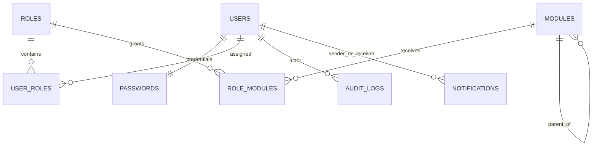

# Database model

This document describes the PostgreSQL DDL and seed statements supplied with the project. It does not claim that every table is used by the visible application or that the database enforces relationships beyond the declared primary keys.

## Model overview

The lines above represent the apparent logical relationships of the table names and columns. The supplied DDL does **not** declare foreign-key constraints for these relationships. `histories` is a generic entity/id history table and has no declared FK. `passcodes` is independent in the supplied DDL.

## Table catalogue

### `code_masters`

Generic code/name lookup table.

| Column | Type | Notes |
|---|---|---|
| `master` | `varchar(100)` | Part of primary key |
| `code` | `varchar(100)` | Part of primary key |
| `name` | `varchar(100)` | Display name |
| `sequence` | `int8` | Ordering value |
| `status` | `char(1)` | Status; seed uses `A` and `I` |

Primary key: (`master`, `code`). Supplied seeds define language values (`en`, `vi`) and date format values. Active/inactive status in this table should not be assumed to match every other table's status convention.

### `modules`

Navigation/authorization module catalogue, including a parent field for hierarchy.

| Column | Type | Notes |
|---|---|---|
| `module_id` | `varchar(40)` | Primary key |
| `module_name` | `varchar(255)` | Required display name |
| `status` | `char(1)` | Required; authorization SQL filters `A` |
| `path` | `varchar(255)` | Seeded route path |
| `resource_key` | `varchar(255)` | Resource/localization key in seed/config usage |
| `icon` | `varchar(255)` | Icon identifier in seed data |
| `sequence` | `int` | Required ordering value |
| `actions` | `int4` | Integer; bit/action meanings are not supplied |
| `parent` | `varchar(40)` | Parent module identifier; no FK declared |
| `created_by`, `updated_by` | `varchar(40)` | Audit actors |
| `created_at`, `updated_at` | `timestamptz` | Audit timestamps |

Seeded modules: `admin`, `setup`, `report`, `user`, `role`, `audit_log`, `currency`, `country`, and `locale`. The seeded paths include `/users`, `/roles`, `/audit-logs`, `/currencies`, `/countries`, and `/locales`.

### `users`

| Column | Type | Notes |
|---|---|---|
| `user_id` | `varchar(40)` | Primary key |
| `username` | `varchar(255)` | Required |
| `email` | `varchar(255)` | Required |
| `display_name` | `varchar(255)` | Optional display name |
| `status` | `char(1)` | Required; config defines activated `A`, deactivated `D` |
| `gender` | `char(1)` | Domain values are not supplied |
| `phone` | `varchar(20)` | |
| `title` | `varchar(10)` | |
| `position` | `varchar(40)` | |
| `image_url` | `varchar(500)` | |
| `language` | `varchar(5)` | Config/auth query reads user language |
| `dateformat` | `varchar(12)` | Config/auth query aliases this as `date_format` |
| `max_password_age` | `integer` | |
| `created_by`, `updated_by` | `varchar(40)` | Audit actors |
| `created_at`, `updated_at` | `timestamptz` | Audit timestamps |

### `passwords`

Authentication state keyed by `user_id`.

| Column | Type | Notes |
|---|---|---|
| `user_id` | `varchar(40)` | Primary key; logically corresponds to `users.user_id` |
| `password` | `varchar(255)` | Password credential/hash field; never expose it |
| `success_time` | `timestamptz` | Last successful authentication time |
| `fail_time` | `timestamptz` | Failed authentication time |
| `fail_count` | `integer` | Failure counter |
| `locked_until_time` | `timestamptz` | Lockout boundary |
| `changed_time` | `timestamptz` | Password change time |
| `history` | `character varying[]` | Password history; never expose it |

The supplied authentication query inner-joins `users` and `passwords` on `user_id` and filters active users by username. The DDL does not declare a foreign key from `passwords` to `users`.

### `passcodes`

| Column | Type | Notes |
|---|---|---|
| `id` | `varchar(40)` | Primary key |
| `code` | `varchar(500)` | Required; treat as secret |
| `expired_at` | `timestamptz` | Required expiration timestamp |

No relation or lifecycle implementation is visible in the supplied source.

### `roles`

| Column | Type | Notes |
|---|---|---|
| `role_id` | `varchar(40)` | Primary key |
| `role_name` | `varchar(255)` | Required |
| `status` | `char(1)` | Required |
| `remark` | `varchar(255)` | |
| `created_by`, `updated_by` | `varchar(40)` | Audit actors |
| `created_at`, `updated_at` | `timestamptz` | Audit timestamps |

Visible role templates use active/inactive values `A` and `I`; the exact role-status semantics should be checked against service code when available.

### `user_roles`

Many-to-many assignment between users and roles.

| Column | Type | Notes |
|---|---|---|
| `user_id` | `varchar(40)` | Part of primary key |
| `role_id` | `varchar(40)` | Part of primary key |

Primary key: (`user_id`, `role_id`). No foreign keys are declared in the supplied DDL.

### `role_modules`

Role-to-module grants.

| Column | Type | Notes |
|---|---|---|
| `role_id` | `varchar(40)` | Part of primary key |
| `module_id` | `varchar(40)` | Part of primary key |
| `permissions` | `int` | Integer permission value; bit meanings are not supplied |

Primary key: (`role_id`, `module_id`). `config.ts` reads this column when producing effective privileges and a module-specific permission. Do not assume which numeric values represent create/read/update/delete or other actions.

### `audit_logs`

| Column | Type | Notes |
|---|---|---|
| `id` | `varchar(255)` | Primary key |
| `resource` | `varchar(255)` | |
| `user_id` | `varchar(255)` | Actor identifier stored as text |
| `ip` | `varchar(255)` | |
| `action` | `varchar(255)` | |
| `time` | `timestamptz` | Event time |
| `status` | `varchar(255)` | |
| `remark` | `varchar(255)` | |

The archive includes an audit-log list template, but not the code that records or queries audit events.

### `histories`

Generic entity history records.

| Column | Type | Notes |
|---|---|---|
| `history_id` | `varchar(40)` | Primary key |
| `entity` | `varchar(40)` | Required entity type/name |
| `id` | `varchar(40)` | Required entity identifier |
| `author` | `varchar(40)` | Required actor identifier |
| `time` | `timestamptz` | Required event time |
| `action` | `char(1)` | Action code; values are not supplied |
| `data` | `jsonb` | Flexible historical data |

No writer, reader, JSON shape, or action-code mapping is included in the visible source.

### `notifications`

| Column | Type | Notes |
|---|---|---|
| `id` | `varchar(40)` | Primary key |
| `sender` | `varchar(40)` | Required sender identifier |
| `receiver` | `varchar(40)` | Required receiver identifier |
| `message` | `varchar(1000)` | Required message |
| `url` | `varchar(200)` | Optional link |
| `time` | `timestamptz` | Required timestamp |
| `status` | `char(1)` | Status values are not supplied |

### `currency`

| Column | Type | Notes |
|---|---|---|
| `code` | `varchar(3)` | Primary key |
| `symbol` | `varchar(6)` | Required |
| `decimal_digits` | `int4` | |
| `status` | `char(1)` | List/detail templates use `A` and `I` |

### `locale`

| Column | Type | Notes |
|---|---|---|
| `code` | `varchar(40)` | Primary key |
| `name` | `varchar(255)` | |
| `native_name` | `varchar(255)` | |
| `country_code` | `varchar(5)` | |
| `country_name` | `varchar(255)` | |
| `native_country_name` | `varchar(255)` | |
| `date_format` | `varchar(14)` | |
| `first_day_of_week` | `int2` | |
| `decimal_separator` | `varchar(3)` | |
| `group_separator` | `varchar(3)` | |
| `currency_code` | `char(3)` | |
| `currency_symbol` | `varchar(6)` | |
| `currency_decimal_digits` | `int2` | |
| `currency_pattern` | `int2` | |
| `currency_sample` | `varchar(40)` | |

### `country`

| Column | Type | Notes |
|---|---|---|
| `country_code` | `varchar(5)` | Primary key |
| `country_name` | `varchar(255)` | |
| `native_country_name` | `varchar(255)` | |
| `date_format` | `varchar(14)` | |
| `decimal_separator` | `varchar(3)` | |
| `group_separator` | `varchar(3)` | |
| `currency_code` | `char(3)` | |
| `currency_symbol` | `varchar(6)` | |
| `currency_decimal_digits` | `int2` | |
| `currency_pattern` | `int2` | |
| `currency_sample` | `varchar(40)` | |
| `status` | `char(1)` | List/detail templates use `A` and `I` |

## Important status and permission cautions

- `A` appears as active in seeded module rows and visible currency/country/locale/role forms.
- `I` appears as inactive in visible master-data forms and code-master seeds.
- `config.ts` explicitly configures user activation as `A` and deactivation as `D`. Do not normalize this to `I` without evidence.
- `modules.actions` and `role_modules.permissions` are numeric. Their bitmask/action meanings are not present in the supplied source.
- The provided DDL has primary keys but no explicit `FOREIGN KEY`, `CHECK`, or additional `CREATE INDEX` declarations. Do not document or rely on database-enforced constraints that are not present.

## Supplied privilege SQL behavior

`config.ts` defines three statements:

1. `allPrivileges`: selects active modules and their navigation metadata.
2. `privileges`: traverses user-role-role-module-module joins, filters active roles and modules, and returns each module's metadata together with its `permissions` and `actions` values.
3. `permission`: retrieves distinct permission integers for one user/module pair and explicitly filters the user, role, and module to active status.

Notable difference: the supplied `privileges` query does not include the explicit `u.status = 'A'` predicate that appears in the `permission` query. Preserve existing SQL behavior unless a deliberate authorization change is requested and reviewed.
